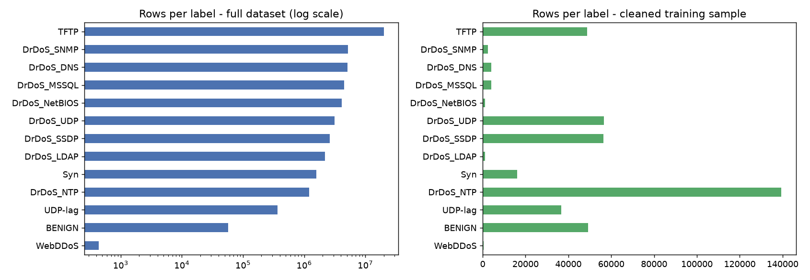
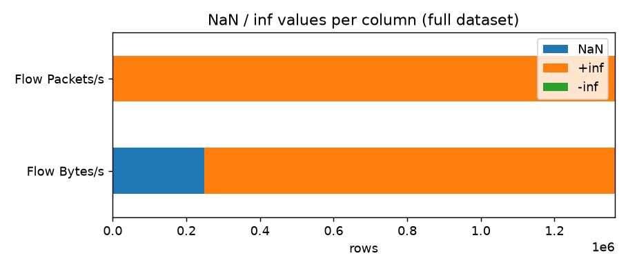

# CIC-DDoS2019 (01-12) - data inspection and cleaning report

## 1. Attack types
Total rows in the 11 CSV files: **50,063,112**. Distinct labels: **13** (12 attack types + BENIGN).

| Label | rows | share |
|---|---|---|
| TFTP | 20,082,580 | 0.4011 |
| DrDoS_SNMP | 5,159,870 | 0.1031 |
| DrDoS_DNS | 5,071,011 | 0.1013 |
| DrDoS_MSSQL | 4,522,492 | 0.09034 |
| DrDoS_NetBIOS | 4,093,279 | 0.08176 |
| DrDoS_UDP | 3,134,645 | 0.06261 |
| DrDoS_SSDP | 2,610,611 | 0.05215 |
| DrDoS_LDAP | 2,179,930 | 0.04354 |
| Syn | 1,582,289 | 0.03161 |
| DrDoS_NTP | 1,202,642 | 0.02402 |
| UDP-lag | 366,461 | 0.00732 |
| BENIGN | 56,863 | 0.001136 |
| WebDDoS | 439 | 8.769e-06 |

Labels found per source file (each file is dominated by its own attack, BENIGN rows are spread across files):

| Label | DrDoS_UDP.csv | DrDoS_NetBIOS.csv | DrDoS_DNS.csv | DrDoS_SNMP.csv | DrDoS_MSSQL.csv | UDPLag.csv | DrDoS_LDAP.csv | DrDoS_NTP.csv | DrDoS_SSDP.csv | Syn.csv | TFTP.csv |
|---|---|---|---|---|---|---|---|---|---|---|---|
| DrDoS_UDP | 3,134,645 | 0 | 0 | 0 | 0 | 0 | 0 | 0 | 0 | 0 | 0 |
| BENIGN | 2,157 | 1,707 | 3,402 | 1,507 | 2,006 | 3,705 | 1,612 | 14,365 | 763 | 392 | 25,247 |
| DrDoS_NetBIOS | 0 | 4,093,279 | 0 | 0 | 0 | 0 | 0 | 0 | 0 | 0 | 0 |
| DrDoS_DNS | 0 | 0 | 5,071,011 | 0 | 0 | 0 | 0 | 0 | 0 | 0 | 0 |
| DrDoS_SNMP | 0 | 0 | 0 | 5,159,870 | 0 | 0 | 0 | 0 | 0 | 0 | 0 |
| DrDoS_MSSQL | 0 | 0 | 0 | 0 | 4,522,492 | 0 | 0 | 0 | 0 | 0 | 0 |
| UDP-lag | 0 | 0 | 0 | 0 | 0 | 366,461 | 0 | 0 | 0 | 0 | 0 |
| WebDDoS | 0 | 0 | 0 | 0 | 0 | 439 | 0 | 0 | 0 | 0 | 0 |
| DrDoS_LDAP | 0 | 0 | 0 | 0 | 0 | 0 | 2,179,930 | 0 | 0 | 0 | 0 |
| DrDoS_NTP | 0 | 0 | 0 | 0 | 0 | 0 | 0 | 1,202,642 | 0 | 0 | 0 |
| DrDoS_SSDP | 0 | 0 | 0 | 0 | 0 | 0 | 0 | 0 | 2,610,611 | 0 | 0 |
| Syn | 0 | 0 | 0 | 0 | 0 | 0 | 0 | 0 | 0 | 1,582,289 | 0 |
| TFTP | 0 | 0 | 0 | 0 | 0 | 0 | 0 | 0 | 0 | 0 | 20,082,580 |

## 2. Columns
The CSVs have 88 columns. **43** are used as model features; the rest are identifiers (kept as metadata for inspection) or dropped:

| column | status | reason |
|---|---|---|
| Source IP | metadata | identifier, kept as metadata only |
| Source Port | metadata | identifier, kept as metadata only |
| Destination IP | metadata | identifier, kept as metadata only |
| Destination Port | metadata | identifier, kept as metadata only (attack-specific in CIC, would not transfer) |
| Protocol | feature | reproducible from pcap by ddos.flowmeter |
| Timestamp | metadata | identifier, kept as metadata only |
| Flow Duration | feature | reproducible from pcap by ddos.flowmeter |
| Total Fwd Packets | feature | reproducible from pcap by ddos.flowmeter |
| Total Backward Packets | feature | reproducible from pcap by ddos.flowmeter |
| Total Length of Fwd Packets | feature | reproducible from pcap by ddos.flowmeter |
| Total Length of Bwd Packets | feature | reproducible from pcap by ddos.flowmeter |
| Fwd Packet Length Max | feature | reproducible from pcap by ddos.flowmeter |
| Fwd Packet Length Min | feature | reproducible from pcap by ddos.flowmeter |
| Fwd Packet Length Mean | feature | reproducible from pcap by ddos.flowmeter |
| Fwd Packet Length Std | feature | reproducible from pcap by ddos.flowmeter |
| Bwd Packet Length Max | feature | reproducible from pcap by ddos.flowmeter |
| Bwd Packet Length Min | feature | reproducible from pcap by ddos.flowmeter |
| Bwd Packet Length Mean | feature | reproducible from pcap by ddos.flowmeter |
| Bwd Packet Length Std | feature | reproducible from pcap by ddos.flowmeter |
| Flow Bytes/s | feature | reproducible from pcap by ddos.flowmeter |
| Flow Packets/s | feature | reproducible from pcap by ddos.flowmeter |
| Flow IAT Mean | feature | reproducible from pcap by ddos.flowmeter |
| Flow IAT Std | feature | reproducible from pcap by ddos.flowmeter |
| Flow IAT Max | feature | reproducible from pcap by ddos.flowmeter |
| Flow IAT Min | feature | reproducible from pcap by ddos.flowmeter |
| Fwd IAT Total | feature | reproducible from pcap by ddos.flowmeter |
| Fwd IAT Mean | feature | reproducible from pcap by ddos.flowmeter |
| Fwd IAT Std | feature | reproducible from pcap by ddos.flowmeter |
| Fwd IAT Max | feature | reproducible from pcap by ddos.flowmeter |
| Fwd IAT Min | feature | reproducible from pcap by ddos.flowmeter |
| Bwd IAT Total | feature | reproducible from pcap by ddos.flowmeter |
| Bwd IAT Mean | feature | reproducible from pcap by ddos.flowmeter |
| Bwd IAT Std | feature | reproducible from pcap by ddos.flowmeter |
| Bwd IAT Max | feature | reproducible from pcap by ddos.flowmeter |
| Bwd IAT Min | feature | reproducible from pcap by ddos.flowmeter |
| Fwd PSH Flags | dropped | CICFlowMeter flag counting is unreliable (see table below) |
| Bwd PSH Flags | dropped | CICFlowMeter flag counting is unreliable (see table below) |
| Fwd URG Flags | dropped | CICFlowMeter flag counting is unreliable (see table below) |
| Bwd URG Flags | dropped | CICFlowMeter flag counting is unreliable (see table below) |
| Fwd Header Length | dropped | CICFlowMeter bug (negative values for UDP) |
| Bwd Header Length | dropped | CICFlowMeter bug (negative values for UDP) |
| Fwd Packets/s | feature | reproducible from pcap by ddos.flowmeter |
| Bwd Packets/s | feature | reproducible from pcap by ddos.flowmeter |
| Min Packet Length | feature | reproducible from pcap by ddos.flowmeter |
| Max Packet Length | feature | reproducible from pcap by ddos.flowmeter |
| Packet Length Mean | feature | reproducible from pcap by ddos.flowmeter |
| Packet Length Std | feature | reproducible from pcap by ddos.flowmeter |
| Packet Length Variance | feature | reproducible from pcap by ddos.flowmeter |
| FIN Flag Count | dropped | CICFlowMeter flag counting is unreliable (see table below) |
| SYN Flag Count | dropped | CICFlowMeter flag counting is unreliable (see table below) |
| RST Flag Count | dropped | CICFlowMeter flag counting is unreliable (see table below) |
| PSH Flag Count | dropped | CICFlowMeter flag counting is unreliable (see table below) |
| ACK Flag Count | dropped | CICFlowMeter flag counting is unreliable (see table below) |
| URG Flag Count | dropped | CICFlowMeter flag counting is unreliable (see table below) |
| CWE Flag Count | dropped | CICFlowMeter flag counting is unreliable (see table below) |
| ECE Flag Count | dropped | CICFlowMeter flag counting is unreliable (see table below) |
| Down/Up Ratio | feature | reproducible from pcap by ddos.flowmeter |
| Average Packet Size | feature | reproducible from pcap by ddos.flowmeter |
| Avg Fwd Segment Size | feature | reproducible from pcap by ddos.flowmeter |
| Avg Bwd Segment Size | feature | reproducible from pcap by ddos.flowmeter |
| Fwd Header Length.1 | dropped | duplicate of Fwd Header Length |
| Fwd Avg Bytes/Bulk | dropped | bulk feature, constant 0 in the sample |
| Fwd Avg Packets/Bulk | dropped | bulk feature, constant 0 in the sample |
| Fwd Avg Bulk Rate | dropped | bulk feature, constant 0 in the sample |
| Bwd Avg Bytes/Bulk | dropped | bulk feature, constant 0 in the sample |
| Bwd Avg Packets/Bulk | dropped | bulk feature, constant 0 in the sample |
| Bwd Avg Bulk Rate | dropped | bulk feature, constant 0 in the sample |
| Subflow Fwd Packets | dropped | identical to Total Fwd Packets |
| Subflow Fwd Bytes | dropped | identical to Total Length of Fwd Packets |
| Subflow Bwd Packets | dropped | identical to Total Backward Packets |
| Subflow Bwd Bytes | dropped | identical to Total Length of Bwd Packets |
| Init_Win_bytes_forward | feature | reproducible from pcap by ddos.flowmeter |
| Init_Win_bytes_backward | feature | reproducible from pcap by ddos.flowmeter |
| act_data_pkt_fwd | dropped | inconsistent (0 for UDP flows with payload) |
| min_seg_size_forward | dropped | derived from header length, unreliable |
| Active Mean | dropped | depends on CICFlowMeter 5 s activity timeout, not reproduced |
| Active Std | dropped | depends on CICFlowMeter 5 s activity timeout, not reproduced |
| Active Max | dropped | depends on CICFlowMeter 5 s activity timeout, not reproduced |
| Active Min | dropped | depends on CICFlowMeter 5 s activity timeout, not reproduced |
| Idle Mean | dropped | depends on CICFlowMeter 5 s activity timeout, not reproduced |
| Idle Std | dropped | depends on CICFlowMeter 5 s activity timeout, not reproduced |
| Idle Max | dropped | depends on CICFlowMeter 5 s activity timeout, not reproduced |
| Idle Min | dropped | depends on CICFlowMeter 5 s activity timeout, not reproduced |
| Inbound | dropped | testbed-specific direction flag |
| Label | target | attack label |
| Unnamed: 0 | dropped | row index of the original export |
| Flow ID | dropped | identifier (5-tuple string) |
| SimillarHTTP | dropped | dataset-specific string, mostly 0 |

Why flag counts are dropped - mean SYN/ACK flag count per label in the sample (a SYN flood with SYN=0 and ACK=1 shows the counters are wrong):

| Label | SYN Flag Count | ACK Flag Count |
|---|---|---|
| BENIGN | 0.00401 | 0.1728 |
| DrDoS_DNS | 1.333e-05 | 0.0001067 |
| DrDoS_LDAP | 2.667e-05 | 0.0001067 |
| DrDoS_MSSQL | 0 | 5.333e-05 |
| DrDoS_NTP | 0 | 0.0009267 |
| DrDoS_NetBIOS | 0 | 0.0001733 |
| DrDoS_SNMP | 6.667e-06 | 6e-05 |
| DrDoS_SSDP | 0 | 8.667e-05 |
| DrDoS_UDP | 2.667e-05 | 0.0002333 |
| Syn | 0.00012 | 0.9995 |
| TFTP | 0 | 0.007793 |
| UDP-lag | 0.0001133 | 0.8655 |
| WebDDoS | 0 | 0.3303 |

## 3. Missing and infinite values
Counts over the full population (all rows of all files):

| column | NaN | +inf | -inf | share_of_rows |
|---|---|---|---|---|
| Flow Bytes/s | 249,024 | 1,114,212 | 0 | 0.02723 |
| Flow Packets/s | 0 | 1,363,236 | 0 | 0.02723 |

All NaN/inf values come from flows with `Flow Duration == 0`: CICFlowMeter divides bytes and packets by a zero duration (0/0 = NaN, x/0 = inf), while `Fwd/Bwd Packets/s` are written as 0 for the same rows. Rates for those flows are recomputed with a 1 us duration floor (`ddos.features.fix_rates`); the identical convention is used by the pcap flow meter, so training and inference agree. For every other row the recomputed rates equal the CSV values exactly.

Zero-duration flows in the sample: 60,661 (3.55%).

Negative values in model features (population; `Init_Win_bytes_* = -1` is a valid 'no packet' marker and excluded):

none

## 4. Cleaning steps (on the sample)

| step | rows remaining |
|---|---|
| sampled rows | 1,707,302 |
| keep TCP/UDP only (Protocol 0 = unparsed traffic) | 1,705,629 |
| drop rows still containing NaN/inf | 1,705,629 |
| drop rows with impossible negative values | 1,705,629 |
| drop duplicate (features, label) rows | 416,011 |

Feature vectors that appear with both a BENIGN and an attack label: **22**. They are kept (they are genuinely ambiguous) and bound the achievable accuracy.

## 5. Class imbalance
Population: 56,863 BENIGN vs 50,006,249 attack rows - imbalance ratio **1 : 879**.

Handling: (a) per-label uniform sampling with K = 150,000 rows (rare labels kept entirely), which also balances the attack types against each other; (b) class weights in training. After cleaning: 49,239 BENIGN vs 366,772 attack rows (1 : 7.4).

| Label | population | sample | clean |
|---|---|---|---|
| TFTP | 20,082,580 | 150,000 | 48,649 |
| DrDoS_SNMP | 5,159,870 | 150,000 | 2,351 |
| DrDoS_DNS | 5,071,011 | 150,000 | 3,925 |
| DrDoS_MSSQL | 4,522,492 | 150,000 | 3,943 |
| DrDoS_NetBIOS | 4,093,279 | 150,000 | 1,162 |
| DrDoS_UDP | 3,134,645 | 150,000 | 56,599 |
| DrDoS_SSDP | 2,610,611 | 150,000 | 56,394 |
| DrDoS_LDAP | 2,179,930 | 150,000 | 1,074 |
| Syn | 1,582,289 | 150,000 | 16,151 |
| DrDoS_NTP | 1,202,642 | 150,000 | 139,389 |
| UDP-lag | 366,461 | 150,000 | 36,723 |
| BENIGN | 56,863 | 56,863 | 49,239 |
| WebDDoS | 439 | 439 | 412 |

