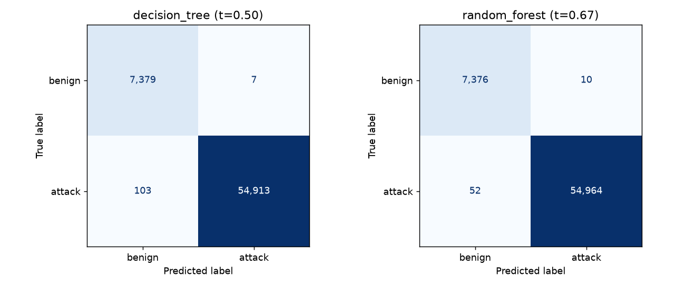
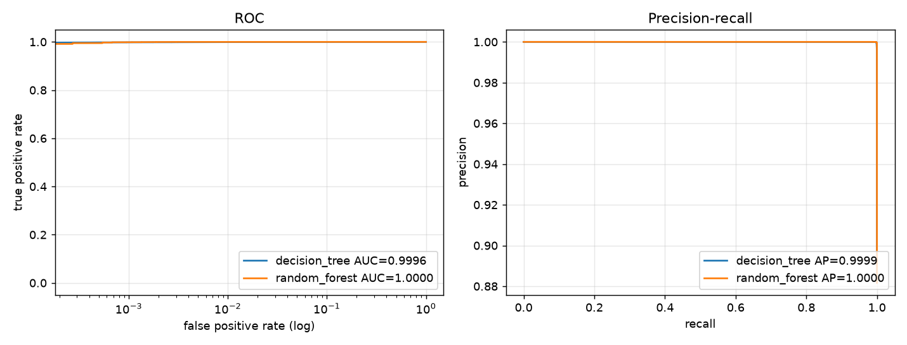
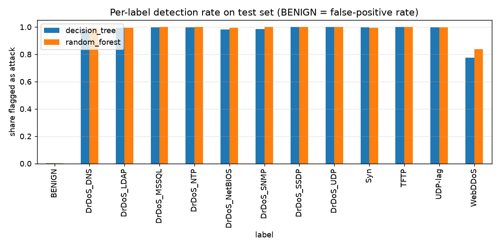
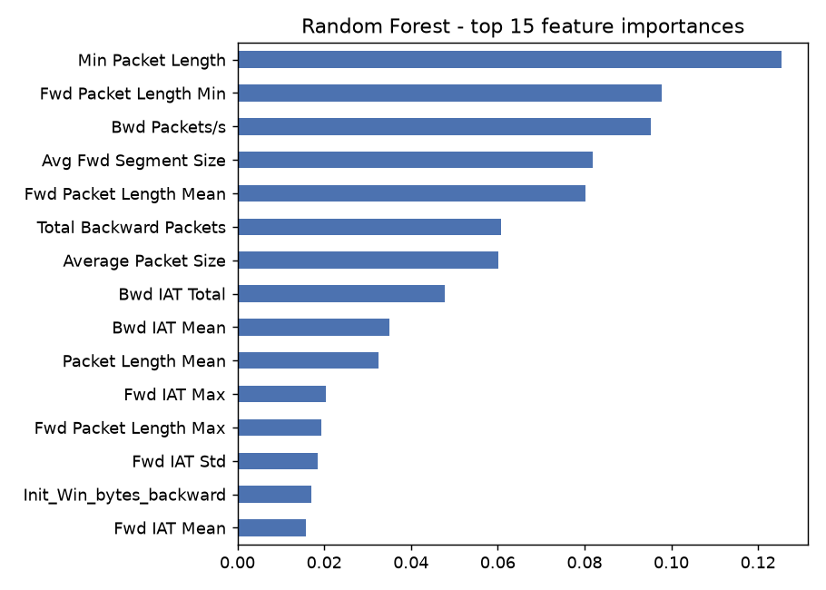

# Model training and evaluation

Rows: 416,011 (train 291,207 / val 62,402 / test 62,402). Features: 43. Threshold tuned on validation: max TPR - FPR with benign FPR <= 1.0%.

**Caveat:** the split is random over flows captured on a single day, so near-identical flows of one attack land in both train and test. These scores measure in-distribution accuracy; transfer to new traffic is evaluated on the live testbed (results/report).

## decision_tree

Fit 3 s, prediction 0.4 us/flow, threshold **0.50**.

| split | accuracy | precision | recall | F1 | FPR | ROC-AUC | PR-AUC |
|---|---|---|---|---|---|---|---|
| val | 0.9983 | 0.9999 | 0.9982 | 0.9990 | 0.0008 | 0.9997 | 0.9999 |
| test | 0.9982 | 0.9999 | 0.9981 | 0.9990 | 0.0009 | 0.9996 | 0.9999 |
| test @0.5 | 0.9982 | 0.9999 | 0.9981 | 0.9990 | 0.0009 | 0.9996 | 0.9999 |

Test confusion matrix: TN=7,379 FP=7 FN=103 TP=54,913

Share of test flows flagged as attack, per original label (BENIGN row = FPR):

| label | test rows | flagged |
|---|---|---|
| BENIGN | 7,386 | 0.0009 |
| DrDoS_DNS | 588 | 0.9813 |
| DrDoS_LDAP | 161 | 0.9938 |
| DrDoS_MSSQL | 591 | 0.9966 |
| DrDoS_NTP | 20,909 | 0.9986 |
| DrDoS_NetBIOS | 175 | 0.9829 |
| DrDoS_SNMP | 353 | 0.9858 |
| DrDoS_SSDP | 8,459 | 0.9996 |
| DrDoS_UDP | 8,490 | 0.9993 |
| Syn | 2,422 | 0.9988 |
| TFTP | 7,298 | 0.9993 |
| UDP-lag | 5,508 | 0.9964 |
| WebDDoS | 62 | 0.7742 |

### False positives (7 benign test flows flagged)

By protocol: 17: 6, 6: 1. Top destination ports: 53 (2), 52057 (1), 443 (1), 53311 (1), 59690 (1), 58628 (1).

| feature | false positives | true negatives | attacks |
|---|---|---|---|
| Protocol | 17 | 6 | 17 |
| Flow Duration | 1 | 2.104e+04 | 1.067e+05 |
| Total Fwd Packets | 2 | 2 | 6 |
| Total Backward Packets | 0 | 2 | 0 |
| Fwd Packet Length Mean | 83 | 31 | 416 |
| Flow Packets/s | 2e+06 | 191.3 | 37.53 |
| Init_Win_bytes_forward | -1 | 253 | -1 |
| Init_Win_bytes_backward | -1 | -1 | -1 |

Pattern: 100% of false positives are flows lasting <= 10 us (vs 3% of true negatives). With the 1 us duration floor their packet rates reach ~10^6 pps, the same signature as a flood burst, and two packets carry too little evidence to separate them. The monitor's per-source voting (several attack flows required before a block) is the safeguard against acting on these single-flow errors.

False negatives by attack type: DrDoS_NTP: 30, UDP-lag: 20, WebDDoS: 14, DrDoS_DNS: 11, DrDoS_UDP: 6, DrDoS_SNMP: 5, TFTP: 5, Syn: 3, DrDoS_NetBIOS: 3, DrDoS_SSDP: 3, DrDoS_MSSQL: 2, DrDoS_LDAP: 1.

## random_forest

Fit 6 s, prediction 2.5 us/flow, threshold **0.67**.

| split | accuracy | precision | recall | F1 | FPR | ROC-AUC | PR-AUC |
|---|---|---|---|---|---|---|---|
| val | 0.9992 | 0.9999 | 0.9992 | 0.9995 | 0.0008 | 1.0000 | 1.0000 |
| test | 0.9990 | 0.9998 | 0.9991 | 0.9994 | 0.0014 | 1.0000 | 1.0000 |
| test @0.5 | 0.9994 | 0.9997 | 0.9995 | 0.9996 | 0.0019 | 1.0000 | 1.0000 |

Test confusion matrix: TN=7,376 FP=10 FN=52 TP=54,964

Share of test flows flagged as attack, per original label (BENIGN row = FPR):

| label | test rows | flagged |
|---|---|---|
| BENIGN | 7,386 | 0.0014 |
| DrDoS_DNS | 588 | 0.9898 |
| DrDoS_LDAP | 161 | 0.9938 |
| DrDoS_MSSQL | 591 | 1.0000 |
| DrDoS_NTP | 20,909 | 0.9995 |
| DrDoS_NetBIOS | 175 | 0.9943 |
| DrDoS_SNMP | 353 | 1.0000 |
| DrDoS_SSDP | 8,459 | 1.0000 |
| DrDoS_UDP | 8,490 | 0.9998 |
| Syn | 2,422 | 0.9955 |
| TFTP | 7,298 | 0.9995 |
| UDP-lag | 5,508 | 0.9989 |
| WebDDoS | 62 | 0.8387 |

### False positives (10 benign test flows flagged)

By protocol: 17: 6, 6: 4. Top destination ports: 53 (2), 443 (2), 53311 (1), 59690 (1), 58628 (1), 51841 (1), 50534 (1), 52057 (1).

| feature | false positives | true negatives | attacks |
|---|---|---|---|
| Protocol | 17 | 6 | 17 |
| Flow Duration | 1 | 2.104e+04 | 1.067e+05 |
| Total Fwd Packets | 2 | 2 | 6 |
| Total Backward Packets | 0 | 2 | 0 |
| Fwd Packet Length Mean | 41 | 31 | 416 |
| Flow Packets/s | 2e+06 | 191.3 | 37.53 |
| Init_Win_bytes_forward | -1 | 253 | -1 |
| Init_Win_bytes_backward | -1 | -1 | -1 |

Pattern: 80% of false positives are flows lasting <= 10 us (vs 3% of true negatives). With the 1 us duration floor their packet rates reach ~10^6 pps, the same signature as a flood burst, and two packets carry too little evidence to separate them. The monitor's per-source voting (several attack flows required before a block) is the safeguard against acting on these single-flow errors.

False negatives by attack type: DrDoS_NTP: 11, Syn: 11, WebDDoS: 10, UDP-lag: 6, DrDoS_DNS: 6, TFTP: 4, DrDoS_UDP: 2, DrDoS_LDAP: 1, DrDoS_NetBIOS: 1.

