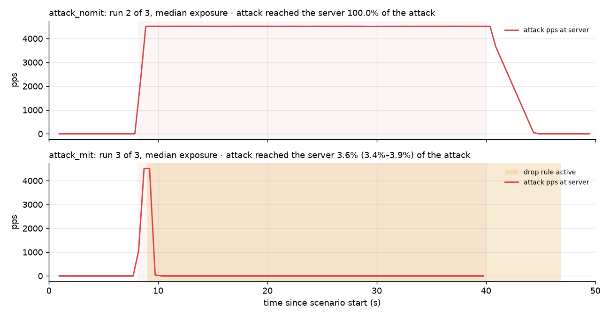
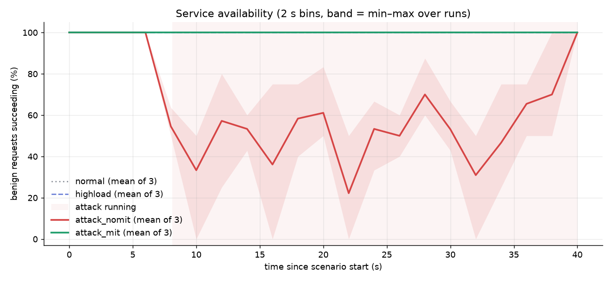
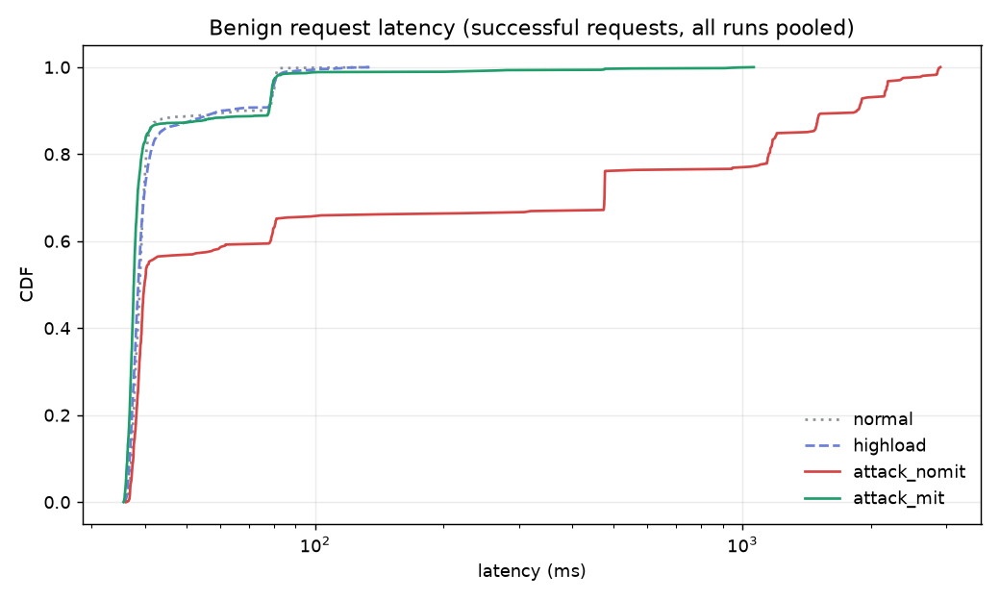
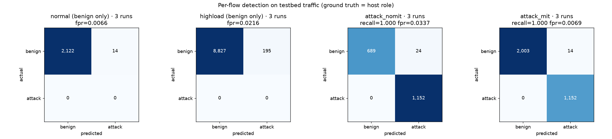

# Testbed experiment results

Comparison of normal operation, high (benign) load, and controlled suspicious traffic with mitigation disabled vs enabled.

Each scenario was run **3 times**; values are **mean (min–max)** over the runs.

## Service availability

| scenario | runs | attack | mitigation | requests | success overall | success during attack | median latency (ms) |
|---|---|---|---|---|---|---|---|
| normal | 3 | - | off | 446 (403–470) | 100.0% | 100.0% | 38.9 (38.8–39.0) |
| highload | 3 | - | off | 1901 (1871–1918) | 100.0% | 100.0% | 38.6 (38.5–38.6) |
| attack_nomit | 3 | udp | off | 176 (161–189) | 76.2% (75.4%–77.0%) | 52.8% (49.4%–57.5%) | 40.1 (39.3–40.8) |
| attack_mit | 3 | udp | on | 441 (403–462) | 100.0% | 100.0% | 37.7 (37.6–37.8) |

## Detection and mitigation

Detection latency runs from the first attack packet on the server link to the monitor's first block decision. Exposure is how much of the attack actually reached the server. Detect-only scenarios (mitigation off) log the blocks they *would* have requested (dry run), so they have no API or switch latency.

| scenario | detection (s) | API (ms) | switch confirm (ms) | attack exposure | block requests | renewals | false blocks (benign) |
|---|---|---|---|---|---|---|---|
| normal | - | - | - | - | 0 | 0 | none |
| highload | - | - | - | - | 0 | 0 | none |
| attack_nomit | 0.76 (0.58–0.86) | dry run | - | 100.0% · 31.9 s | 6 | 0 | none |
| attack_mit | 0.78 (0.58–0.89) | 3.56 (1.72–5.27) | 2.10 (1.37–3.00) | 3.6% (3.4%–3.9%) · 1.1 (1.1–1.2) s | 3 | 3 | none |

## Per-flow detection on testbed traffic

Counts are summed over all runs; rates are computed from the totals.

| scenario | flows | TP | FP | FN | TN | recall | precision | FPR |
|---|---|---|---|---|---|---|---|---|
| normal | 2,136 | - | 14 | - | 2,122 | - | - | 0.0066 |
| highload | 9,022 | - | 195 | - | 8,827 | - | - | 0.0216 |
| attack_nomit | 1,865 | 1,152 | 24 | 0 | 689 | 1.000 | 0.980 | 0.0337 |
| attack_mit | 3,169 | 1,152 | 14 | 0 | 2,003 | 1.000 | 0.988 | 0.0069 |

Per-flow false positives never became blocks unless listed under *false blocks*: the monitor needs several attack flows from one source before it acts.

## Benign flows flagged as attack

| scenario | flagged (all runs) | zero-payload TCP | fwd-only (no reply) | median duration (ms) |
|---|---|---|---|---|
| normal | 14 | 14 | 4 | 1.4 |
| highload | 195 | 195 | 66 | 1.0 |
| attack_nomit | 24 | 24 | 22 | 718.0 |
| attack_mit | 14 | 14 | 11 | 0.1 |

Zero-payload TCP flows carry no request data: connection tails left over when a flow is closed at FIN (as CICFlowMeter does), and SYN retransmissions from clients whose packets are being dropped by the flooded link. Both look like the SYN-flood class the model learned from CIC-DDoS2019.

## Capture health

The live monitor reads its own copy of the traffic (tap); `capture.pcap` is a separate archive capture. If the monitor cannot keep up, the kernel drops tap packets and its telemetry, detections and blocks are based on partial data.

| scenario | live monitor (tap) dropped | archive capture dropped |
|---|---|---|
| normal | 0 of 20,616 (0.0%) | 0 of 20,616 (0.0%) |
| highload | 0 of 86,226 (0.0%) | 0 of 86,226 (0.0%) |
| attack_nomit | 0 of 448,810 (0.0%) | 0 of 448,810 (0.0%) |
| attack_mit | 0 of 34,129 (0.0%) | 0 of 34,129 (0.0%) |

